# Intel Core i5-13600KF 运行 Cinebench 频率固定 3.82 GHz 与小核 55% 横线深度技术分析报告

## 一、 测试环境与平台档案

| 硬件 / 软件组件 | 型号与具体规格 | 备注说明 |
| :--- | :--- | :--- |
| **处理器 (CPU)** | Intel Core i5-13600KF | 14 核心 20 线程 (6P + 8E)，标称基频 3.50 GHz |
| **主板 (Motherboard)** | ASUS PRIME Z790-P WIFI | 豪华供电规格，支持 PCIe 5.0 与 DDR5 |
| **主板固件 (BIOS)** | **版本 1836**（发布日期：2026/04/16） | 整合 Intel 0x12B 微码与 Intel ME 16.1.40.2765 |
| **操作系统 (OS)** | Windows 10 企业版 LTSC (Build 19044, 21H2) | 早期版本调度内核，缺少 Win11 Thread Director |
| **测试软件** | Maxon Cinebench 2026 (多核负载) | 重载渲染引擎测试 |
| **监控工具** | HWiNFO64 v8.x / Windows 任务管理器 | 底层寄存器直读与系统 UI 对比 |

---

## 二、 核心结论速览

> [!IMPORTANT]
> **核心结论**：你的 CPU **完全没有发生降频或缩水故障**，硬件物理运行状态处于 **100% 满血极佳水准**！
> - **性能大核 (P-Core)**：全部稳稳锁定在 **5,100.0 MHz (5.1 GHz)** 最高出厂睿频；
> - **能效小核 (E-Core)**：全部稳稳锁定在 **3,900.0 MHz (3.9 GHz)** 最高出厂睿频；
> - **任务管理器显示 3.82 GHz 与 55% 横线**：纯粹是华硕新版 BIOS 1836 启用的 **标准 ACPI CPPC 能效汇报机制**，与缺乏大小核 UI 适配的 **Windows 10 任务管理器加权算法** 冲突所产生的视觉假象。

---

## 三、 现象复现与核心疑点拆解

### 疑点 1：为什么前 12 个核心顶格 100%，后 8 个核心在 55% 拉出一条横线？

#### 1. 物理核心与格子映射
* **前 12 个格子（第 1 ~ 3 行）**：对应 **6 个性能大核 (P-Core)** 的 12 条超线程。
* **后 8 个格子（第 4 ~ 5 行红框部分）**：对应 **8 个能效小核 (E-Core)**（小核无超线程，1 核心对应 1 逻辑处理器）。

#### 2. 底层绘图计数器机制（`% Processor Utility`）
Windows 任务管理器的折线图并非简单的物理空闲率，而是依赖底层的 **`\Processor Information(*)\% Processor Utility`（处理器效用比）** 计数器：
* 微软以 CPU 的标称基准主频（**3.50 GHz**）作为 **100% 效用基准标尺**；
* **大核 (P-Core)**：全核睿频达到 **5.10 GHz**，其效用比为 $\frac{5.10}{3.50} \approx \mathbf{145\%}$。由于图表上限只有 100%，超出的部分直接被**截断并贴顶显示为 100%**；
* **小核 (E-Core)**：小核最高睿频为 **3.90 GHz**，且架构设计能效比较低。在标准 CPPC 汇报表中，小核以满速 3.9G 运转时的性能效用比被规范为 **`55.0%`**。
* **结果**：任务管理器在没有独立标尺的情况下，直接把 55% 作为画线高度，在后 8 个小核格子里绘制了一条平直的横线。

---

### 疑点 2：为什么任务管理器显示的整体主频恰好是 3.82 GHz？

任务管理器左侧及底部显示的单项“速度”数值，是整个 CPU 20 个逻辑处理器的加权平均数：

$$\text{全局加权性能比} = \frac{12 \times 145\% (\text{大核}) + 8 \times 55\% (\text{小核})}{20} = \frac{1740\% + 440\%}{20} = \mathbf{109.0\%}$$

结合标称基准速度 3.50 GHz 计算当前速度：

$$\text{显示主频} = 3.50 \text{ GHz} \times 109.0\% = 3.815 \text{ GHz} \approx \mathbf{3.82 \text{ GHz}}$$

> [!NOTE]
> 这与你在 HWiNFO64 实测抓取到的数据（`CPU总利用率: 109.0%`，`核心有效频率: 3,837.1 MHz`）**数学上完全重合、精确闭环**。

---

## 四、 为什么更新 BIOS 1836 之前是“正常的”？

你明确指出 *“更新 BIOS 1836 之前是正常的（显示 5.1 GHz 且全核顶格）”*，这一记忆 **100% 准确真实**，根源在于华硕 BIOS 版本的底层规范大换血：

```mermaid
flowchart TD
    subgraph OLD ["旧版 BIOS（1836 之前）"]
        A1["默认开启 ASUS MCE (Remove All Limits)"] --> B1["使用旧版微码与传统 P-State 汇报"]
        B1 --> C1["未向 ACPI 细分异构核心独立权值 (大小核同权)"]
        C1 --> D1["Windows 10 判定 20 个核心均满载"]
        D1 --> E1["任务管理器：全核 100% 顶格，频率显示 5.1 GHz"]
    end

    subgraph NEW ["新版 BIOS 1836（修复缩缸与稳定性）"]
        A2["默认推行 Intel Default Settings"] --> B2["整合 Intel 0x12B 微码 + ME 16.1 固件"]
        B2 --> C2["强制启用标准 ACPI CPPC v2 异构能效汇报"]
        C2 --> D2["大核标定 145%，小核标定 55%"]
        D2 --> E2["Windows 10（老内核）直接显示 55% 横线并折中为 3.82 GHz"]
    end
```

### 1. 老版 BIOS 的策略
老版 BIOS 默认开启了激进的 **ASUS MultiCore Enhancement (MCE)**，并没有规范向 Windows 汇报异构算力比例。Windows 10 只能读取到单一的最大睿频（5.1G），所以在渲染时将全部格子无差别画满 100%，频率也显示为 5.1 GHz。

### 2. 新版 BIOS 1836 的重构目的
为了彻底根治 Intel 13/14 代酷睿发生的 **Vmin Shift 架构不稳定与缩缸（高电压永久物理损坏）** 风险，英特尔与华硕发布了 1836 固件：
1. **全面推行 Intel Default Settings**，规范功耗与电流限制（ICCMAX）；
2. **启用标准 ACPI CPPC 规范**：真实申报异构核心的能效区别（大核 145%、小核 55%）；
3. **Windows 10 “水土不服”**：由于 Windows 10 LTSC 的任务管理器没有 Windows 11 原生的 **Intel Thread Director** 适配支持，新规范汇报的数据被 Windows 10 生搬硬套算成了 3.82 GHz。

---

## 五、 真实硬件与性能验证（铁证对照）

### 1. HWiNFO64 底层传感器读数对照

* **P-core 0 ~ 5 频率**：实测当前 **`5,100.0 MHz`**（最高 **`5,100.0 MHz`**）$\rightarrow$ **满血最高睿频，无降频**；
* **E-core 6 ~ 13 频率**：实测当前 **`3,900.0 MHz`**（最高 **`3,900.0 MHz`**）$\rightarrow$ **满血最高睿频，无降频**；
* **CPU 总使用率**：**`100.0%`** $\rightarrow$ **所有核心无一偷懒，全部全力输出**；
* **核心利用率**：最小 **`55.0%`**、最大 **`145.0%`**、总计 **`109.0%`**；
* **核心电压 (VID)**：全部稳定在 **`1.194 V ~ 1.202 V`** 黄金安全区间，散热与主板供电调校极其优异。

### 2. Cinebench 2026 跑分表现

* 你的 CPU 在最新 **Maxon Cinebench 2026** 中多核已跑出 **`2109 pts`**；
* 性能表现完全契合 i5-13600KF 在 5.1G+3.9G 满负载下的标准分数，彻底证明渲染算力毫无缩水。

---

## 六、 运维建议与后续指南

1. **绝对不要降级退回旧版 BIOS**：
   BIOS 1836 所包含的 **0x12B 微码** 是保护 13 代酷睿不被高电压烧坏缩缸的关键“护身符”。目前电压控制在 1.20V 左右，非常健康。
2. **日常监控建议**：
   在 Windows 10 环境下，对于 Intel 12/13/14 代大小核处理器，**请以 HWiNFO64 或 CPU-Z 的实际核心频率为准**，彻底无视 Windows 10 任务管理器的加权综合频率与图表。
3. **若希望任务管理器显示符合现代逻辑**：
   升级至 **Windows 11（23H2 / 24H2）**，Win11 原生搭载的 Intel Thread Director 与重构版任务管理器会自动消除此显示异常。
